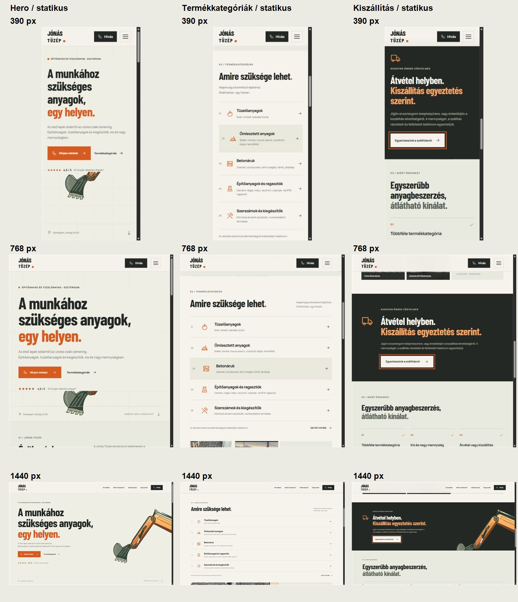
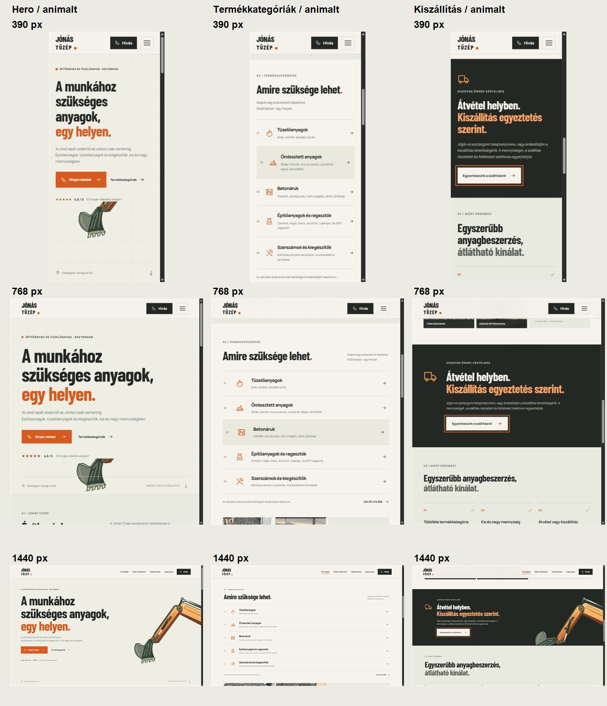

# Maszk nélküli markoló – kétlépcsős ellenőrzés

## Megvalósítás

- Egyetlen gyökérszintű fixed dekoráció maradt, `pointer-events: none` beállítással, a fejléc alatt.
- Nincs maszkolás, blur, DOM-szövegbejárás, tartalomfelismerés, ResizeObserver vagy fontbetöltéshez kötött maszkfrissítés.
- A CSS-kompozíciót a komponens `data-layout` attribútuma választja ki. Ugyanaz a media query határozza meg az SVG viewBoxát, képarányát és a kompakt/desktop elrendezést.
- A sűrű tartalmi szekciók normál átlátszatlan hátteret kaptak. A dekoráció ezek mögött rejtett. Kompakt nézeten a kiszállítás is ilyen felület, desktopon a jobb oldali grafika mögött megmarad az eredeti sötét háttér, a szöveg saját átlátszatlan felületen van.
- A hero szövegblokkja az eredeti alapszínű olvasási felület. A grafika mögötte helyezkedik el; az üres alsó padding nem takarja.
- Nem változott a weboldal szövege, tipográfiája, navigációja vagy szekcióinak sorrendje.

## 1. Statikus ellenőrzés

Az animáció először ideiglenesen rögzített, 28%-os pózban volt. A hero, termékkategóriák és kiszállítás nézetet 390, 768 és 1440 px szélességen képernyőképen ellenőriztem.

A statikus képek alapján javítottam a tablet alsó takarását, a kompakt kiszállításnál látható apró géptöredéket és a desktop kanál szövegfelület mögé kerülő bal szélét. A javított hero- és kiszállításnézeteket ismét ellenőriztem. Csak ezután távolítottam el az ideiglenes statikus kapcsolót.

## 2. Animációs ellenőrzés

Újabb kilenc képernyőkép készült a végleges scrollvezérléssel:

| Szélesség | Hero | Termékkategóriák | Kiszállítás |
| --- | --- | --- | --- |
| 390 px | [Kép](animalt-390-hero.jpg) | [Kép](animalt-390-termekek.jpg) | [Kép](animalt-390-kiszallitas.jpg) |
| 768 px | [Kép](animalt-768-hero.jpg) | [Kép](animalt-768-termekek.jpg) | [Kép](animalt-768-kiszallitas.jpg) |
| 1440 px | [Kép](animalt-1440-hero.jpg) | [Kép](animalt-1440-termekek.jpg) | [Kép](animalt-1440-kiszallitas.jpg) |

A [mérések](meresek.json) mindegyikében egyetlen fixed komponens szerepel, a fejléc alatt, `mask-image: none` mellett, vízszintes túlcsordulás nélkül. Az animált szakaszok között az SVG dobozának pozíciója/mérete és a dokumentum magassága szélességenként változatlan.

Az átlátszatlan tartalmi szekciók mögött a grafika továbbra is ugyanazon a fix rétegen van, de nem látszik át rajtuk. Ez szándékos olvashatósági szabály, nem hiányzó SVG vagy megszakadó animáció.

## Programozott ellenőrzés

- `node qa/markolo/verify-animation.cjs`: dokumentumalapú scroll-progress, visszafordulás, valódi csuklópontok, változatlan kompozíció, nyugalomban leálló RAF-ciklus, a maszkolórendszer hiánya.
- Ugyanez a teszt a reduced-motion statikus pózát is ellenőrzi mindkét kompozíción. A rendszer mozgásbeállítását a képernyőképek készítéséhez nem változtattam meg.
- `npm run build`: TypeScript-ellenőrzés és Vite produkciós build, sikeres.

Nem történt telepítés vagy publikálás.
