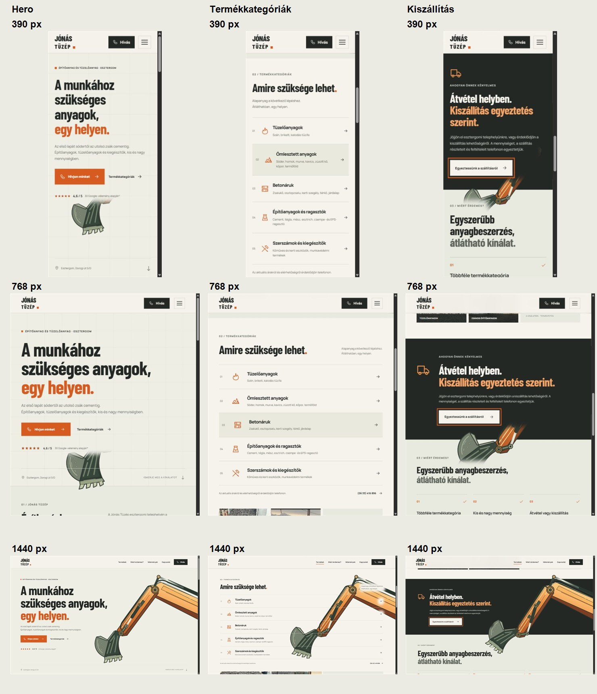

# Markoló – felmérés és ellenőrzés

## Feltárt okok

- A korábbi SVG egyszerre kapott szélesség- és magasságkorlátot. A `meet` illesztés emiatt belső üres teret hagyott, így a CSS-doboz mérete nem mutatta jól a gép tényleges méretét.
- A szövegsoronként előállított éles maszk a gépet vízszintes töredékekre vágta.
- A szekciók eredeti háttérszabályai és az utólagos háttér-felülírások külön helyeken szerepeltek.
- A fix réteg szülője már a gyökérelem volt: ezt megőriztem. Nincs transzformált fixed-szülő vagy külön oldalsáv.

## Végleges rétegzés

`src/excavator.css` tartalmazza a dekorációhoz tartozó szabályokat. A szekciók háttere a 0., a gyökérszintű fix dekoráció az 1., a tartalom a 2., a fejléc a 10. rétegen van. A `main` és a szekciók nem hoznak létre külön stacking contextet. Az SVG egységes skálázást kap, a desktop és kompakt nézet dokumentált geometriájához illesztett képaránnyal.

A tartalmi csoportok lágy szélű luminanciamaszkot kapnak. Kompakt nézeten a sűrű terméklista egésze védett: ott a grafika tudatosan rejtett, nem apró csíkokban bukkan elő. Desktopon a szabad jobb oldali területen látszik. A maszk sem a szöveg színét, sem a dokumentum elrendezését nem módosítja.

## Böngészős ellenőrzés

Mind a kilenc alábbi nézet képernyőképen ellenőrizve. A navigáció, szövegek és CTA-k olvashatók; a dekoráció a fejléc alatt marad. Mindegyik mérésnél egyetlen fix dekoráció található, vízszintes túlcsordulás nélkül. A számszerű eredmények a [meresek.json](meresek.json) fájlban szerepelnek.

| Szélesség | Hero | Termékkategóriák | Kiszállítás |
| --- | --- | --- | --- |
| 390 px | [Kép](390-hero.jpg) | [Kép](390-termekek.jpg) | [Kép](390-kiszallitas.jpg) |
| 768 px | [Kép](768-hero.jpg) | [Kép](768-termekek.jpg) | [Kép](768-kiszallitas.jpg) |
| 1440 px | [Kép](1440-hero.jpg) | [Kép](1440-termekek.jpg) | [Kép](1440-kiszallitas.jpg) |

## Animáció és build

- A böngészőben 390 px-en a kanál 8°-ról 80°-ra fordult a teljes oldal végiggörgetésekor, majd visszanyílt.
- Az SVG doboza a teljes görgetés alatt változatlan: `[15.90625, 370.1640625, 343.1875, 363.984375]`.
- A dokumentum magassága végig 5577 px maradt. A zárt kanál is az SVG saját keretén belül van.
- A hook-regresszióteszt a desktop/mobil célértékeket, a valódi csuklópontokat, a visszafordulást, a statikus reduced-motion állapotot, a változatlan kompozíciót és az animációs ciklus leállását ellenőrzi. Futtatás: `node qa/markolo/verify-animation.cjs`.
- A `npm run build` tartalmazza a TypeScript-ellenőrzést és a Vite produkciós buildet.

A reduced-motion logikát a regresszióteszt ellenőrzi; az operációs rendszer beállítását a böngészős képekhez nem módosítottam.
